<!-- SPDX-License-Identifier: Apache-2.0 -->

# Hover map

A map of how the browser runtime decides when to look at the picture and when to show a card. It
covers the files listed under [Coverage](#coverage) and nothing else. The
[hover spec](hover-spec.md) states the rules, one clause per behavior, with the tests that check
them. This page shows the structure and the flows: which part decides what, and in what order the
parts talk. It does not repeat the rules; each element links the clause that states its rule.

**Checked by `tests/test_hover_map.py`.** Every anchor below must name a file that exists and a
symbol that file defines, every clause id must exist in the spec, and every covered file must be
anchored at least once. The test checks names. It does not check behavior: a diagram can be wrong
while its names are right, so a change to a covered file updates this page in the same pull
request, and the reviewer reads the diagram.

## How to read it

Three layers, from the whole to the detail.

1. **Frames and messages.** Who runs where, and what they send each other.
2. **Decision points.** The questions the code asks: may a picture be taken, should a look be
   asked for, what is shown.
3. **Flows.** Two cases as sequence diagrams, from the opening event to the card on screen.

Under each diagram a table lists its elements. Each row names an element or a part of one, the
anchors of its code, and the spec clauses it carries out.

- An anchor is `` `browser/src/<file>.ts#<symbol>` ``. A symbol is a function, class, constant,
  type or interface, or `Class.method`. Many are inside another function (the capture controller
  and the compute frame are closures), so the name is enough to find it with a search.
- A clause is written `S-B13` and is defined in [hover-spec.md](hover-spec.md).
- Times and thresholds are in the spec and the code, not here.

How the diagrams are drawn:

- **One diagram answers one question.** A diagram that answers two is split, however small. A big
  diagram that answers one question stays whole; about 15 nodes is a prompt to check whether it
  answers two, not a limit.
- **Overview first, then detail.** Layer 1 is the overview. Layers 2 and 3 zoom in. Each split
  follows a seam in the code: a separate policy, phase or component.
- On GitHub, a large diagram can be zoomed, or opened full screen, from the buttons that appear
  over it.

## Layer 1: the frames and their messages

An extension runs one session across two frames
([extension-session.md](extension-session.md)). The content script lives in the video's page and
holds the viewer's pointer authority. The compute frame is a hidden page of the extension inside
it; it holds the session and the worker. A product draws the tooltip from the card it is told.

### 1a. Who talks to whom

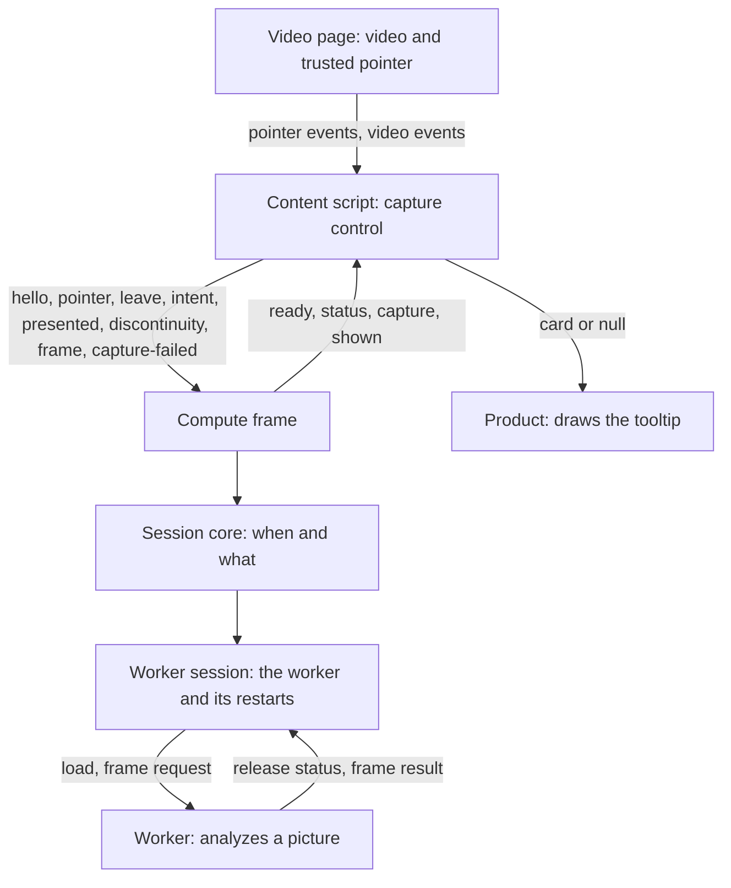

| Element | Anchors | Spec |
| --- | --- | --- |
| Content script: capture control | `browser/src/capture-control.ts#createCaptureControl`, `browser/src/capture-control.ts#CaptureControl`, `browser/src/capture-control.ts#CaptureControlOptions` | S-B1, S-B5, S-B6, S-C17 |
| Video page: video events | `browser/src/video-events.ts#watchVideo`, `browser/src/video-events.ts#VideoWatch` | S-B6, S-W3 |
| Video page: picture and point | `browser/src/capture.ts#pictureBox`, `browser/src/capture.ts#fractionIn`, `browser/src/capture-control.ts#defaultEligible` | S-B5 |
| Taking the picture | `browser/src/page-capture.ts#grabFrame`, `browser/src/page-capture.ts#Grab` | S-B5, S-C10 |
| Which frame a message came from | `browser/src/capture-control.ts#fromExtensionFrame`, `browser/src/capture-control.ts#acceptComputeOut`, `browser/src/capture-control.ts#postWithTransfer` | S-B9, S-X3 |
| The two entries a product vendors | `browser/src/page-capture-entry.ts`, `browser/src/compute-session.ts` | S-X2, S-X4 |
| Compute frame | `browser/src/compute-frame.ts#startComputeFrame`, `browser/src/compute-frame.ts#ComputeFrame`, `browser/src/compute-frame.ts#ComputeFrameEnv` | S-A4, S-A9, S-B9 |
| Messages in | `browser/src/compute-messages.ts#ComputeIn`, `browser/src/compute-messages.ts#parseComputeIn` | S-X2 |
| Messages out | `browser/src/compute-messages.ts#ComputeOut`, `browser/src/compute-messages.ts#parseComputeOut`, `browser/src/compute-messages.ts#ShownCard` | S-X2 |
| The contract and its version | `browser/src/compute-messages.ts#computeProtocol`, `browser/src/compute-messages.ts#PROTOCOL_VERSION` | S-X2 |
| Session core: when and what | `browser/src/session-core.ts#SessionCore`, `browser/src/session-core.ts#SessionCoreDeps`, `browser/src/session-core.ts#SessionCoreOptions` | S-X1 |
| Worker session | `browser/src/worker-session.ts#createWorkerSession`, `browser/src/worker-session.ts#WorkerSession`, `browser/src/worker-session.ts#WORKER_RESTARTS` | S-A9 |
| Worker | `browser/src/worker.ts#host`, `browser/src/worker-host.ts#createWorkerHost` | S-A3, S-X1 |
| Worker messages | `browser/src/messages.ts#WorkerRequest`, `browser/src/messages.ts#WorkerReply`, `browser/src/messages.ts#FrameResult`, `browser/src/messages.ts#BUSY_ERROR` | S-C10 |
| Product: draws the tooltip | `browser/src/capture-control.ts#CaptureControlOptions` | S-F1 |
| The same session in one page | `browser/src/session.ts#createSession` | S-C9 |

### 1b. Inside the compute frame

A message from the content script goes to the session core. The core asks the scheduler whether
a look is due, and sends the worker a picture. What the worker answers goes back through the core
to the card that is posted.

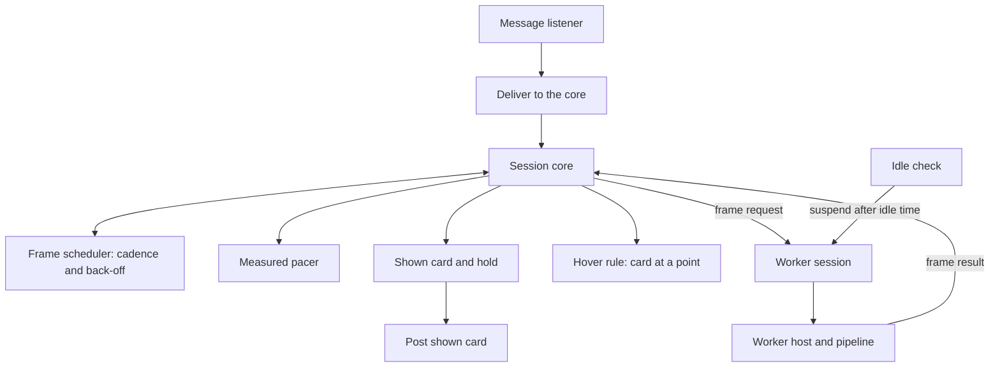

| Element | Anchors | Spec |
| --- | --- | --- |
| Message listener | `browser/src/compute-frame.ts#listener`, `browser/src/compute-frame.ts#answerHello` | S-B9 |
| Deliver to the core | `browser/src/compute-frame.ts#deliver` | S-B7 |
| Session core | `browser/src/session-core.ts#SessionCore.pointer`, `browser/src/session-core.ts#SessionCore.pointerLeft`, `browser/src/session-core.ts#SessionCore.presented`, `browser/src/session-core.ts#SessionCore.discontinuity`, `browser/src/session-core.ts#SessionCore.cut`, `browser/src/session-core.ts#SessionCore.frame`, `browser/src/session-core.ts#SessionCore.captureFailed`, `browser/src/session-core.ts#SessionCore.fromWorker`, `browser/src/session-core.ts#SessionCore.tick` | S-C1, S-C4, S-C17 |
| Frame scheduler | `browser/src/frame-scheduler.ts#FrameScheduler`, `browser/src/frame-scheduler.ts#DRIVER_TICK_MS` | S-C1, S-C10, S-C11 |
| Measured pacer | `browser/src/cadence.ts#MeasuredPacer`, `browser/src/cadence.ts#pacedIntervalMs`, `browser/src/cadence.ts#cadenceMs`, `browser/src/cadence.ts#activeAnalyzeIntervalMs`, `browser/src/cadence.ts#analyzeIntervalMs`, `browser/src/session-core.ts#SessionCore.applyCadence`, `browser/src/session-core.ts#SessionCore.staleBudgetMs` | S-P1, S-P4, S-P5 |
| Worker session | `browser/src/worker-session.ts#createWorkerSession`, `browser/src/worker-session.ts#plainLoad` | S-A9 |
| Worker host and pipeline | `browser/src/worker-host.ts#createWorkerHost`, `browser/src/pipeline.ts#Pipeline`, `browser/src/pipeline.ts#FrameAnalysis` | S-X1 |
| Hover rule: card at a point | `browser/src/hover-at.ts#hoverAt`, `browser/src/hover-at.ts#hoverCardsOf`, `browser/src/hover-layer.ts#selectHoverLayer`, `browser/src/hover-layer.ts#resolveHover`, `browser/src/hover-layer.ts#HoverOutcome` | S-W1 |
| Shown card and hold | `browser/src/session-core.ts#SessionCore.shown`, `browser/src/session-core.ts#SHOWN_HOLD`, `browser/src/session-core.ts#READING_HOLD`, `browser/src/session-core.ts#ShownHold` | S-W4, S-W6 |
| Post shown card | `browser/src/compute-frame.ts#onShown`, `browser/src/compute-frame.ts#postShown`, `browser/src/session-core.ts#SessionCore.publishShown`, `browser/src/session-core.ts#steady` | S-W8 |
| Idle check | `browser/src/compute-frame.ts#checkIdle`, `browser/src/worker-session.ts#suspend`, `browser/src/worker-session.ts#resume` | S-A4, S-A5 |

### 1c. The life of the frames

The product makes the frames (at play, or at the earliest trusted pointer), the compute frame ends
its worker when idle, and the content script removes both frames when told. A trusted move or tap
over the picture makes them again after that.

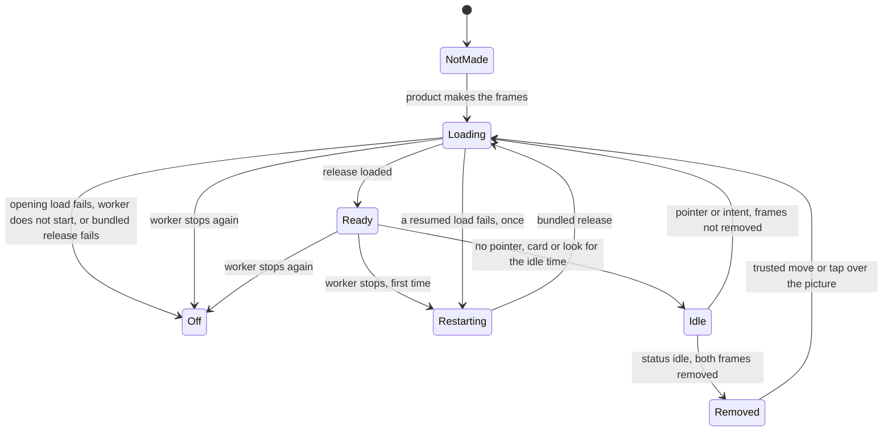

| Element | Anchors | Spec |
| --- | --- | --- |
| The product makes the opening frames | `browser/src/capture-control.ts#loadWhen`, `browser/src/capture-control.ts#CaptureControlOptions`, `browser/src/capture-control.ts#connect` | S-A1, S-A2 |
| Remake after an idle unload | `browser/src/capture-control.ts#makeFrame`, `browser/src/capture-control.ts#removeFrame` | S-A4, S-A6 |
| Handshake | `browser/src/capture-control.ts#hello`, `browser/src/capture-control.ts#onReady` | S-A6, S-B13 |
| Idle and its wake | `browser/src/compute-frame.ts#checkIdle`, `browser/src/compute-frame.ts#resume`, `browser/src/session-core.ts#SessionCore.workerStopped` | S-A4, S-A5 |
| Restart once, then off | `browser/src/worker-session.ts#restartOnBundled`, `browser/src/worker-session.ts#onWorkerError`, `browser/src/worker-session.ts#onReply`, `browser/src/worker-session.ts#turnOff` | S-A9 |
| Geometric stage on the earliest pointer | `browser/src/worker-session.ts#sendStage`, `browser/src/worker-session.ts#splitStage`, `browser/src/worker-host.ts#laterStage` | S-A3 |

### 1d. The shared hover host

A product can take the frames' parts from the shared hover host (experimental) in place of its own
code: three files, one per realm. The content file starts in the video's page and holds the
lifecycle, the main video, the frames and the outline; the compute file starts in the hidden compute
frame; the settings file is for the product's settings page and its background script. The product
keeps its view adapter, its look and its settings schema ([extension-session.md](extension-session.md#the-shared-hover-host)).
The decisions of 1c are one pure step here: it takes an event and the facts the page shows and
answers with the next phase and the effects to run.

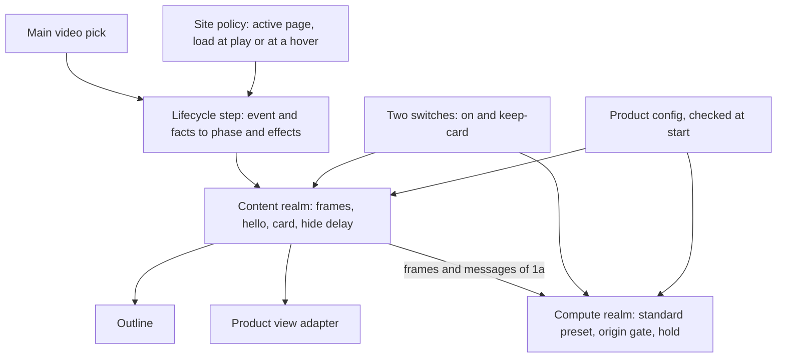

| Element | Anchors | Spec |
| --- | --- | --- |
| The three entries, one per realm | `browser/src/host/content-entry.ts`, `browser/src/host/compute-entry.ts`, `browser/src/host/settings-entry.ts` | S-A1 |
| Product config and its check | `browser/src/host/config.ts#ProductConfig`, `browser/src/host/config.ts#productConfigError` | S-G1 |
| Content realm: frames, hello, card and hide delay | `browser/src/host/content.ts#startHostContent`, `browser/src/host/content.ts#makeView`, `browser/src/host/content.ts#showCard`, `browser/src/host/content.ts#showAgain`, `browser/src/host/content.ts#updateCard`, `browser/src/host/content.ts#onLayout` | S-A10, S-A6, S-W4 |
| The lifecycle step | `browser/src/host/lifecycle.ts#lifecycleStep`, `browser/src/host/lifecycle.ts#LifecycleState`, `browser/src/host/lifecycle.ts#LifecycleFacts`, `browser/src/host/lifecycle.ts#LifecycleEffect` | S-A1, S-A2, S-A6, S-A7, S-A8, S-A10, S-B11, S-H3 |
| Which pages are active, and when they load | `browser/src/host/site-policy.ts#pagePolicy`, `browser/src/host/site-policy.ts#allowedParentOrigin`, `browser/src/host/site-policy.ts#ROUTES` | S-G1, S-G2, S-G3 |
| The main video | `browser/src/host/video-pick.ts#pickMainVideo`, `browser/src/host/video-pick.ts#createVideoPick`, `browser/src/host/video-pick.ts#pictureOf` | S-G4, S-G5 |
| The two switches | `browser/src/host/switches.ts#createSwitches`, `browser/src/host/switches.ts#ENABLED_KEY`, `browser/src/host/switches.ts#KEEP_CARD_KEY` | S-H1, S-H2, S-H3 |
| Settings storage and refresh | `browser/src/host/settings-core.ts#createSettingsCore`, `browser/src/host/settings-core.ts#SettingsCore` | S-H1 |
| The view adapter and its frame handle | `browser/src/host/view.ts#ViewAdapter`, `browser/src/host/view.ts#ViewFrame`, `browser/src/host/view.ts#ViewLayout`, `browser/src/host/view.ts#createViewFrame`, `browser/src/host/view.ts#viewFrameHandle`, `browser/src/host/view.ts#fromViewFrame` | S-A10, S-W1 |
| The outline | `browser/src/host/outline.ts#outlineRect`, `browser/src/host/outline.ts#outlinePlace`, `browser/src/host/outline.ts#CardOutline` | S-F1, S-F3, S-F4 |
| Compute realm: origin gate, preset and hold | `browser/src/host/compute.ts#startHostCompute`, `browser/src/host/compute.ts#STANDARD_PRESET`, `browser/src/host/compute.ts#GEOMETRIC_OPTIONS` | S-A3, S-H2 |

## Layer 2: the decision points

### 2a. May a picture be taken?

The compute frame asks for a picture, and the content script answers from its own record of the
viewer's pointer, never from the request. The gate is a pure function of that record and the
clock. A card showing and the slow start's grant count for a mouse or pen only.

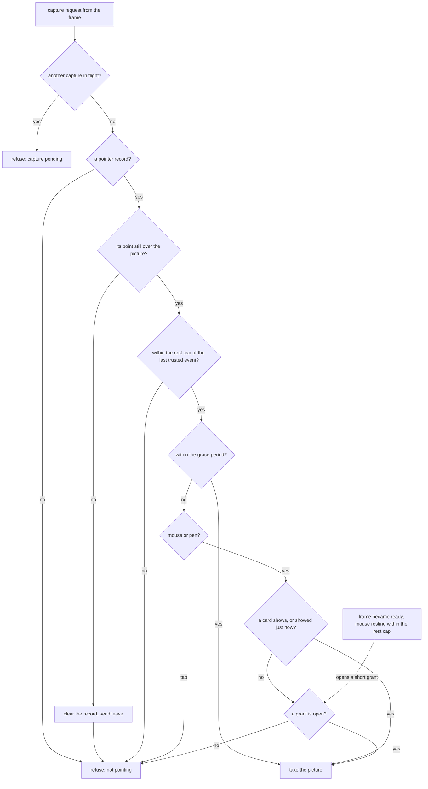

| Element | Anchors | Spec |
| --- | --- | --- |
| Capture request | `browser/src/capture-control.ts#captureFor` | S-B7, S-B8, S-C17 |
| Another capture in flight | `browser/src/capture-control.ts#CAPTURE_PENDING` | S-C17 |
| Last point over the picture | `browser/src/capture-control.ts#captureAllowedNow`, `browser/src/capture-control.ts#where` | S-B5 |
| Clear the record, send leave | `browser/src/capture-control.ts#reset` | S-B5, S-B6 |
| Rest cap, grace, linger | `browser/src/capture-gate.ts#captureAllowed`, `browser/src/capture-gate.ts#MAX_REST_MS`, `browser/src/capture-gate.ts#GateState`, `browser/src/capture-gate.ts#GateLimits` | S-B2, S-B3, S-B4 |
| Mouse or pen, and a tap | `browser/src/capture-control.ts#gateState`, `browser/src/capture-control.ts#Authority`, `browser/src/capture-control.ts#onPointer` | S-B1, S-B4, S-B10 |
| The record of a card showing | `browser/src/capture-control.ts#onMessage` | S-B2, S-B10 |
| The grant | `browser/src/capture-gate.ts#slowStartAllowed`, `browser/src/capture-control.ts#SLOW_START_GRANT_MS`, `browser/src/capture-control.ts#SLOW_START_RETRY_MS`, `browser/src/capture-control.ts#dropGrant` | S-B13 |
| Refusal | `browser/src/capture-control.ts#NOT_POINTING`, `browser/src/capture-control.ts#PICTURE_CHANGED` | S-B1, S-C12 |
| What the frame does with a refusal | `browser/src/session-core.ts#SessionCore.captureFailed` | S-C10, S-C12 |

### 2b. Is a look asked for?

Five kinds of event can ask: a pointer message, a tick, a cut, the end of a load, and a frame told of a resting mouse. All end at one
guarded step, `requestCapture`. They differ in what they wait for: a retry's back-off holds every
path but one, and the cadence holds only the tick.

**A pointer message.**

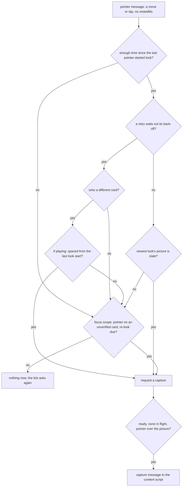

**A tick, a cut, and the end of a load.**

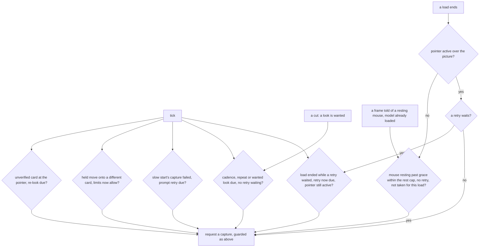

| Element | Anchors | Spec |
| --- | --- | --- |
| Pointer message | `browser/src/session-core.ts#SessionCore.pointer`, `browser/src/frame-scheduler.ts#FrameScheduler.pointerMoved`, `browser/src/frame-scheduler.ts#FrameScheduler.tapped` | S-C5 |
| Gap, stale picture | `browser/src/frame-scheduler.ts#FrameScheduler.hoverTriggerDue`, `browser/src/frame-scheduler.ts#FrameScheduler.frameStale`, `browser/src/frame-scheduler.ts#HOVER_TRIGGER_MIN_GAP_MS`, `browser/src/frame-scheduler.ts#STALE_FRAME_MS` | S-C5, S-C18, S-P5 |
| A retry waits | `browser/src/frame-scheduler.ts#FrameScheduler.retryWaiting`, `browser/src/frame-scheduler.ts#FrameScheduler.lookUnanswered`, `browser/src/frame-scheduler.ts#LOOK_RETRY_MS` | S-C10, S-C11 |
| Onto a different card | `browser/src/session-core.ts#SessionCore.ontoNewCard`, `browser/src/session-core.ts#SessionCore.cardUnderPointer`, `browser/src/session-core.ts#NEW_CARD_DISTANCE` | S-C11 |
| Held move, asked again at the tick | `browser/src/session-core.ts#SessionCore.heldMoveDue` | S-C11 |
| Unverified card re-look | `browser/src/frame-scheduler.ts#FrameScheduler.relookDue`, `browser/src/session-core.ts#SessionCore.relookForUnverified`, `browser/src/session-core.ts#SessionCore.stageReady` | S-C7, S-C8 |
| Tick, cadence and repeats | `browser/src/session-core.ts#SessionCore.tick`, `browser/src/frame-scheduler.ts#FrameScheduler.due` | S-C1, S-C2, S-C14, S-C15 |
| A cut | `browser/src/session-core.ts#SessionCore.cut`, `browser/src/frame-scheduler.ts#FrameScheduler.requestLook` | S-C9, S-C11 |
| A load ends | `browser/src/session-core.ts#SessionCore.lookOnLoad`, `browser/src/frame-scheduler.ts#FrameScheduler.loadEndDue`, `browser/src/session-core.ts#SessionCore.entryEligible` | S-C6, S-P2 |
| Slow start look | `browser/src/session-core.ts#SessionCore.slowStartEligible`, `browser/src/session-core.ts#SessionCore.slowStartRetryDue`, `browser/src/frame-scheduler.ts#FrameScheduler.promptRetryDue` | S-B13, S-C6 |
| A frame told of a resting mouse | `browser/src/session-core.ts#SessionCore.pointerRested`, `browser/src/frame-scheduler.ts#FrameScheduler.pointerRestedSince`, `browser/src/compute-messages.ts#restedField`, `browser/src/compute-frame.ts#deliver` | S-B13 |
| The paced wait and the budget | `browser/src/session-core.ts#SessionCore.applyCadence`, `browser/src/session-core.ts#SessionCore.staleBudgetMs`, `browser/src/session-core.ts#SessionCore.lifetimeMs`, `browser/src/cadence.ts#MeasuredPacer` | S-P1, S-P3, S-P5 |
| The guarded step | `browser/src/session-core.ts#SessionCore.requestCapture`, `browser/src/frame-scheduler.ts#FrameScheduler.started` | S-B7, S-C4, S-C17 |
| A look with no reply | `browser/src/session-core.ts#SessionCore.onFrameResult`, `browser/src/frame-scheduler.ts#ANALYSIS_WATCHDOG_MS`, `browser/src/frame-scheduler.ts#FIRST_ANALYSIS_WATCHDOG_MS` | S-C13 |
| A reply that is too old | `browser/src/frame-scheduler.ts#replyRejection`, `browser/src/frame-scheduler.ts#withinMaxAge`, `browser/src/frame-scheduler.ts#HOVER_MAX_AGE_MS` | S-W2, S-W3 |

### 2c. Is the pointer's analysis running?

In pointer mode the scheduler is in one of three states, which decide whether any look may start
and how far apart the cadence looks are.

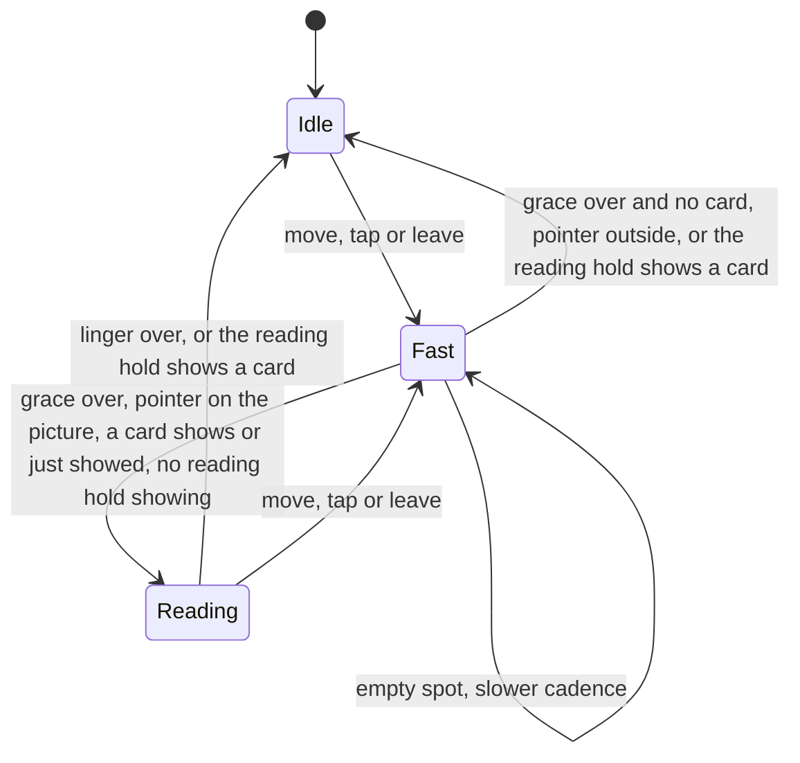

| Element | Anchors | Spec |
| --- | --- | --- |
| The three states | `browser/src/frame-scheduler.ts#FrameScheduler.analysisState`, `browser/src/frame-scheduler.ts#FrameScheduler.pointerState`, `browser/src/frame-scheduler.ts#AnalysisState` | S-C1, S-C2, S-C3 |
| Grace and linger | `browser/src/frame-scheduler.ts#POINTER_GRACE_MS`, `browser/src/frame-scheduler.ts#READING_LINGER_MS`, `browser/src/frame-scheduler.ts#FrameScheduler.pointerActive` | S-B2, S-C2 |
| Leave starts the grace | `browser/src/frame-scheduler.ts#FrameScheduler.pointerLeft` | S-C4 |
| Empty spot | `browser/src/frame-scheduler.ts#EMPTY_SPOT_INTERVAL_MS`, `browser/src/frame-scheduler.ts#FrameScheduler.lookFoundNoCard`, `browser/src/frame-scheduler.ts#FrameScheduler.intervalInEffectMs` | S-C14 |
| Reading hold stops the looks | `browser/src/frame-scheduler.ts#FrameScheduler.setReadingHoldShowing`, `browser/src/frame-scheduler.ts#FrameScheduler.setTooltipShowing`, `browser/src/session-core.ts#SessionCore.reportShown` | S-C3 |
| Repeats of a still picture | `browser/src/frame-scheduler.ts#REPEAT_INTERVAL_MS`, `browser/src/session-core.ts#SessionCore.isStillRepeat`, `browser/src/session-core.ts#SessionCore.stillNeedsNothing` | S-C15, S-C16 |
| Cadence by backend | `browser/src/cadence.ts#cadenceMs`, `browser/src/cadence.ts#MeasuredPacer` | S-P1 |

### 2d. Is a card shown, and is it held?

Two questions, in order. Is there a fresh card at the pointer? Then, what does the hold do with
that answer? With no hold, the fresh card is shown, or nothing when there is none. The two holds
each have their own diagram.

**Is there a fresh card?** It is the named card of the newest result that may still describe the
picture, at the pointer.

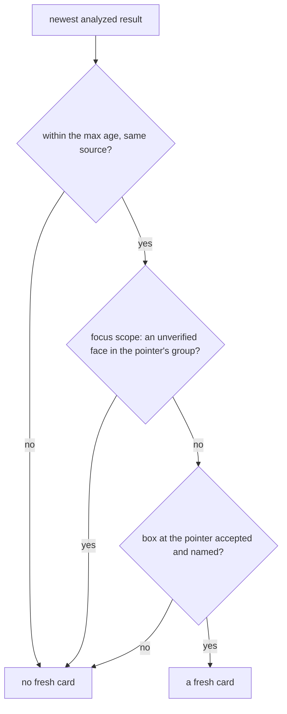

| Element | Anchors | Spec |
| --- | --- | --- |
| The result that may be shown | `browser/src/session-core.ts#SessionCore.current`, `browser/src/session-core.ts#SessionCore.hitAt`, `browser/src/session-core.ts#SessionCore.fresh` | S-W1, S-W2, S-W3 |
| Box at the pointer | `browser/src/hover-at.ts#hoverAt`, `browser/src/hover-layer.ts#resolveHover`, `browser/src/hover-layer.ts#selectHoverLayer` | S-W1 |
| Unverified faces in focus scope | `browser/src/session-core.ts#pointerGroupUnverified`, `browser/src/session-core.ts#SessionCore.pointerGroupHoldsUnverified` | S-W9 |
| Which hold | `browser/src/session-core.ts#SessionCore.shown`, `browser/src/session-core.ts#ShownHold` | S-W4, S-W6 |

**The shown hold.** What is shown when the fresh answer is missing or changes.

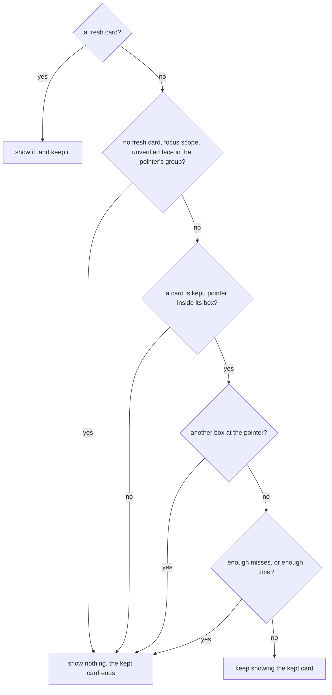

| Element | Anchors | Spec |
| --- | --- | --- |
| Shown hold; an old reply is not a miss | `browser/src/session-core.ts#SHOWN_HOLD`, `browser/src/session-core.ts#SessionCore.boxAtPointer`, `browser/src/session-core.ts#SessionCore.onFrameResult` | S-W2, S-W6 |

**The reading hold.** A shown card stays while the pointer stays where it was seen.

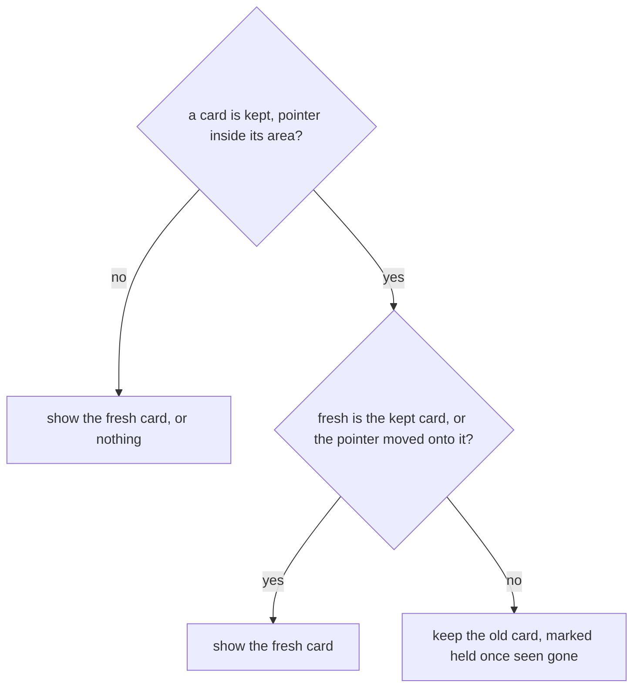

| Element | Anchors | Spec |
| --- | --- | --- |
| Reading hold | `browser/src/session-core.ts#READING_HOLD`, `browser/src/session-core.ts#SessionCore.readingHold`, `browser/src/session-core.ts#SessionCore.movedOnto`, `browser/src/session-core.ts#SessionCore.takeEvidence` | S-W4, S-W5, S-W7 |

**What the card carries and when it is reported.**

| Element | Anchors | Spec |
| --- | --- | --- |
| Held and outline | `browser/src/session-core.ts#Shown`, `browser/src/session-core.ts#turnedOutline` | S-W7, S-F1, S-F2, S-F4 |
| Reported only when it changed | `browser/src/session-core.ts#SessionCore.publishShown`, `browser/src/session-core.ts#steady` | S-W8 |
| Told to the scheduler | `browser/src/session-core.ts#SessionCore.reportShown` | S-C2, S-C3 |

## Layer 3: flows

### 3a. The opening hover on a fresh tab

The frames were not there. The product makes them, and the model loads without waiting for a
pointer. The viewer moves over the picture while it loads. When the load ends the pointer is still
active, so the look is asked at once.

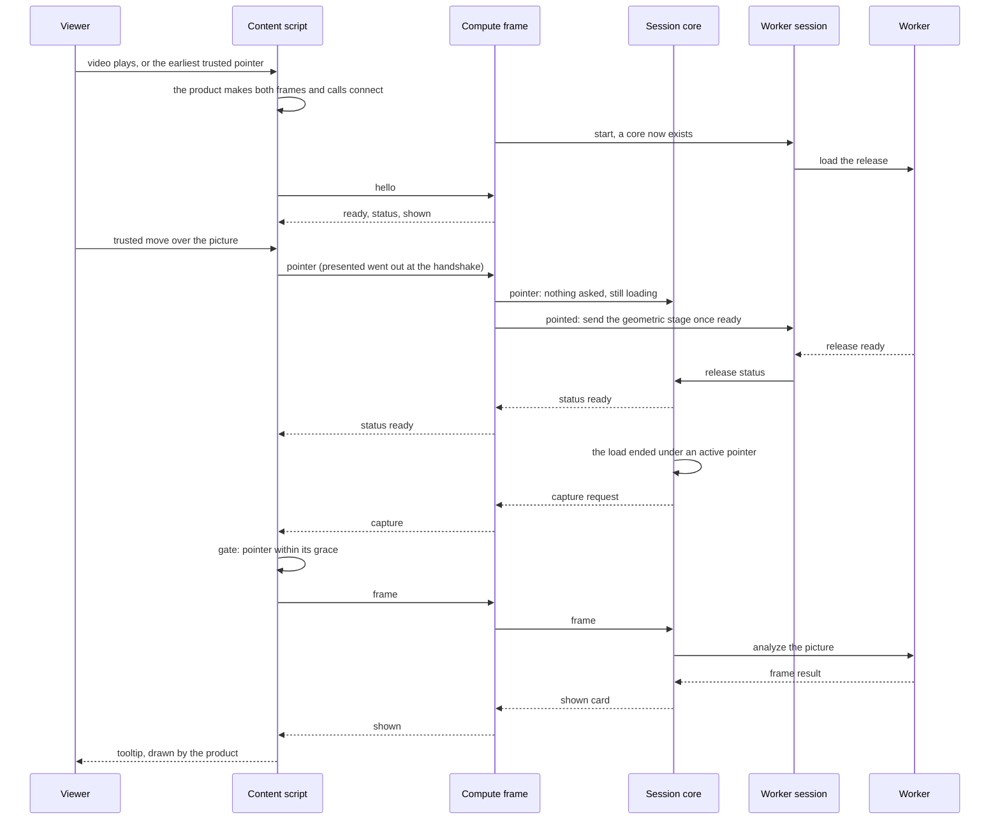

| Step | Anchors | Spec |
| --- | --- | --- |
| The product makes the frames | `browser/src/capture-control.ts#loadWhen`, `browser/src/capture-control.ts#connect` | S-A1, S-A2 |
| The compute frame starts, the release loads | `browser/src/compute-frame.ts#startComputeFrame`, `browser/src/worker-session.ts#createWorkerSession`, `browser/src/worker-session.ts#startWorker` | S-A3 |
| Handshake | `browser/src/capture-control.ts#hello`, `browser/src/compute-frame.ts#answerHello`, `browser/src/capture-control.ts#onReady` | S-B9 |
| The pointer reaches the core | `browser/src/capture-control.ts#onPointer`, `browser/src/capture-control.ts#sendPointer`, `browser/src/compute-frame.ts#deliver`, `browser/src/session-core.ts#SessionCore.pointer` | S-B7 |
| The geometric stage waits for it | `browser/src/worker-session.ts#sendStage` | S-A3 |
| The load ends | `browser/src/session-core.ts#SessionCore.fromWorker`, `browser/src/session-core.ts#SessionCore.lookOnLoad` | S-C6 |
| The request and the gate | `browser/src/session-core.ts#SessionCore.requestCapture`, `browser/src/capture-control.ts#captureFor`, `browser/src/capture-gate.ts#captureAllowed` | S-B2, S-C17 |
| The picture comes back | `browser/src/page-capture.ts#grabFrame`, `browser/src/session-core.ts#SessionCore.frame` | S-B5 |
| The answer is shown | `browser/src/session-core.ts#SessionCore.onFrameResult`, `browser/src/compute-frame.ts#postShown` | S-W1, S-W2 |

### 3b. A resting mouse and a slow model load

The viewer put the pointer on a card and stopped. The model finishes loading after the grace
period has passed, or a frame connects after it. One picture is taken for the pointer that still
rests, and nothing more is asked until it moves, unless the picture finds a card. The compute frame
posts `ready` before the request, so the content script has opened the grant when the request
arrives.

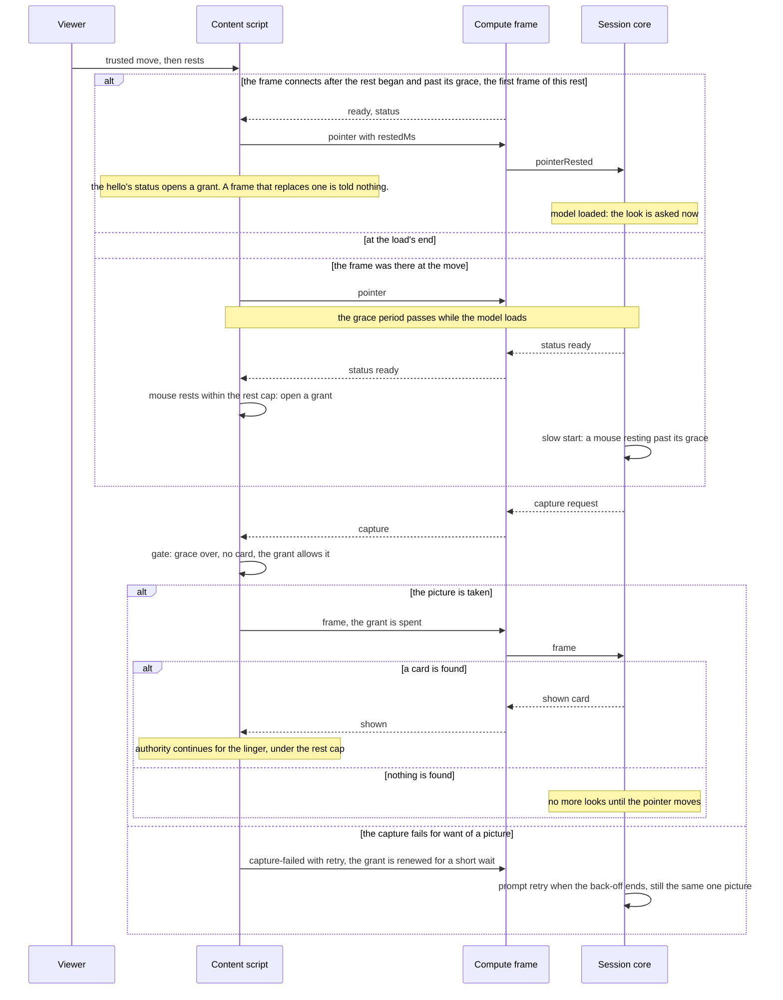

| Step | Anchors | Spec |
| --- | --- | --- |
| The pointer rests | `browser/src/capture-control.ts#onPointer`, `browser/src/frame-scheduler.ts#FrameScheduler.pointerActive` | S-B2 |
| The first frame is told the rest | `browser/src/capture-control.ts#sendPointer`, `browser/src/capture-control.ts#onReady`, `browser/src/capture-control.ts#Authority` | S-B13 |
| A remade frame is told nothing | `browser/src/capture-control.ts#onReady`, `browser/src/capture-control.ts#Authority` | S-B13 |
| The frame takes the rest | `browser/src/compute-frame.ts#deliver`, `browser/src/session-core.ts#SessionCore.pointerRested`, `browser/src/frame-scheduler.ts#FrameScheduler.pointerRestedSince` | S-B13 |
| Ready opens a grant | `browser/src/capture-control.ts#onMessage`, `browser/src/capture-gate.ts#slowStartAllowed`, `browser/src/capture-control.ts#SLOW_START_GRANT_MS` | S-B13 |
| Status before request | `browser/src/session-core.ts#SessionCore.fromWorker` | S-B13, S-C6 |
| The core asks one look | `browser/src/session-core.ts#SessionCore.lookOnLoad`, `browser/src/session-core.ts#SessionCore.slowStartEligible` | S-B13 |
| The grant is spent | `browser/src/capture-control.ts#captureFor`, `browser/src/capture-control.ts#captureAllowedNow` | S-B13 |
| A failed capture is retried on the back-off | `browser/src/capture-control.ts#SLOW_START_RETRY_MS`, `browser/src/session-core.ts#SessionCore.captureFailed`, `browser/src/session-core.ts#SessionCore.slowStartRetryDue` | S-B13, S-C10 |
| A found card keeps the pointer's authority | `browser/src/capture-gate.ts#captureAllowed`, `browser/src/frame-scheduler.ts#FrameScheduler.pointerState` | S-B2, S-B3, S-C2 |

## Coverage

These files are the map's coverage. Each must carry at least one anchor above, and a change to
one of them updates this page in the same pull request. The shared hover host's files under `browser/src/host/` are covered too. Not covered: how a picture is turned into
a card name (detector, recognizer, accept rule, geometric stage, layout fitting), how a release
is chosen and loaded, and a product's own tooltip, look and settings schema.

- `browser/src/cadence.ts`
- `browser/src/capture-control.ts`
- `browser/src/capture-gate.ts`
- `browser/src/capture.ts`
- `browser/src/compute-frame.ts`
- `browser/src/compute-messages.ts`
- `browser/src/compute-session.ts`
- `browser/src/frame-scheduler.ts`
- `browser/src/hover-at.ts`
- `browser/src/hover-layer.ts`
- `browser/src/messages.ts`
- `browser/src/page-capture-entry.ts`
- `browser/src/page-capture.ts`
- `browser/src/pipeline.ts`
- `browser/src/session-core.ts`
- `browser/src/session.ts`
- `browser/src/video-events.ts`
- `browser/src/worker-host.ts`
- `browser/src/worker-session.ts`
- `browser/src/worker.ts`
- `browser/src/host/config.ts`
- `browser/src/host/content.ts`
- `browser/src/host/compute.ts`
- `browser/src/host/view.ts`
- `browser/src/host/settings-core.ts`
- `browser/src/host/switches.ts`
- `browser/src/host/site-policy.ts`
- `browser/src/host/lifecycle.ts`
- `browser/src/host/outline.ts`
- `browser/src/host/video-pick.ts`
- `browser/src/host/content-entry.ts`
- `browser/src/host/compute-entry.ts`
- `browser/src/host/settings-entry.ts`
