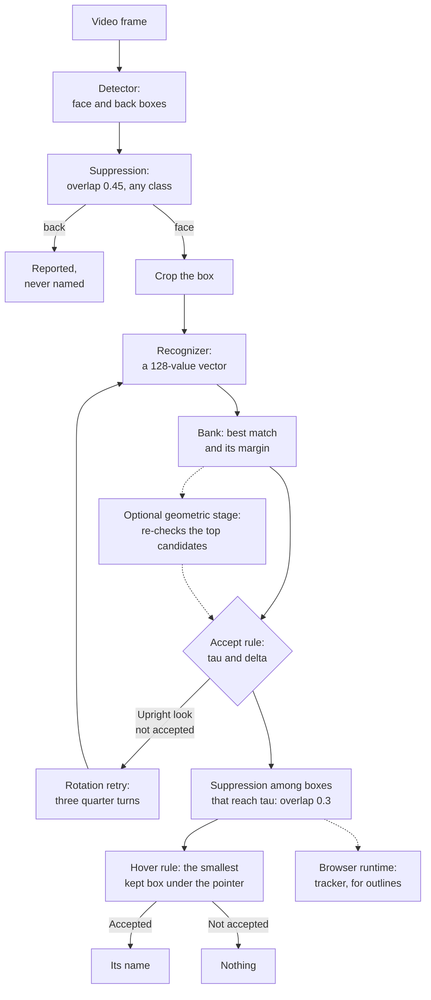
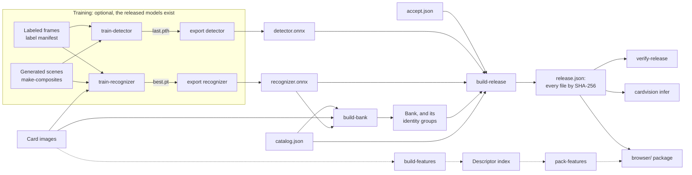

<!-- SPDX-License-Identifier: Apache-2.0 -->

# How it works

This page describes the pipeline from a video frame to a card name. It is written from the
code, and each section names the module that is the final word. The whole process around it,
from your card list to numbers you can state, is in [Start here](start-here.md).

```
frame
  │  brought to a width between 720 and 1920 px
  ▼
detector ──────────► boxes: card face or card back, with a score
  │  faces only; boxes under 24 px are dropped
  ▼
crop ──► recognizer ──► a 128-value vector
                          │  compared with every row of the bank
                          ▼
                     best match and its margin
                          │  accept rule (tau, delta), with a rotation retry
                          ▼
                     a name, or nothing
                          │  hover rule: which box is under the pointer
                          ▼
                     what is shown
```

Two models do the work. The **detector** finds cards and knows nothing about which card is
which. The **recognizer** turns a crop into a vector and knows nothing about any list of
cards. The list of cards is the **bank**: one vector per card, computed from card images. To
add a card you add a row to the bank. No model is retrained.

Two rules decide what is said. The **accept rule** decides whether a match is trusted enough
to name a card. The **hover rule** decides which box a pointer is on. Saying nothing is a
normal result: the design treats a wrong name as worse than a missing one.

## At a glance



**How to read it.** Two models do the work and two rules decide what is said. A dashed line
is optional or belongs to one runtime.

1. **The frame** is brought to a width between 720 and 1920 pixels.
2. **The detector** (YOLOX-Nano) finds boxes of two classes: **face**, a card lying face up,
   and **back**, a card lying face down. Overlapping boxes are thinned by greedy suppression
   at an overlap (IoU) of 0.45, whatever their class. A back is reported and never named.
   Boxes under 24 pixels are dropped.
3. **The crop.** Each face box is cut out of the frame and pooled to a 128 × 128 grid.
4. **The recognizer** turns the crop into a 128-value vector. It knows nothing about any list
   of cards.
5. **The bank** holds one vector per card, computed from card images: the mean of the
   recognizer's vectors for 16 views of the image (the image itself and 15 copies damaged as
   video damages a card). The crop's vector is compared with every row: the **score** is the
   highest similarity, and the **margin** is the score minus the best similarity among rows of
   a different identity. To add a card you add a row to the bank; no model is retrained.
6. **The accept rule.** A look is accepted when its score is at least `tau` and its margin is
   at least `delta`. An accepted look names its card; otherwise the result is nothing.
   Saying nothing is a normal result: a wrong name is treated as worse than a missing one.
7. **The rotation retry.** The upright look is tried, and when it is accepted the turned
   looks are never computed. Otherwise the three quarter turns are computed and all four
   compete.
8. **The optional geometric stage** is off unless you ask for it. It matches keypoints of the
   crop with those of the recognizer's top candidates, fuses the result with the cosine, and
   sends the fused scores through the same accept rule.
9. **The second suppression.** The face boxes whose look reaches `tau` take part in the hover
   rule. They are visited by score, highest first, and a box is kept unless it overlaps a kept
   box by an IoU of 0.3 or more. This is the `accepted-nms` selection a release names.
10. **The hover rule** decides which box the pointer is on: among the kept boxes, the topmost
    one that contains the point, with the smallest box on top. It shows that box's name if
    its look is accepted, and nothing otherwise. A kept box that fails the margin still takes
    the pointer, so a doubtful card on top hides the card beneath it.
11. **The tracker** is in the browser runtime only. It follows the kept boxes from frame to
    frame and names a track from the mean of its last five vectors, for steady outlines. A
    tooltip answers from the current frame and never waits for it. The Python tools analyze
    each frame on its own.

Each step has a section of its own below, which names its module.

## The catalog: the one file a game supplies

Module: `cardvision/core/catalog.py`. Template: `games/_template/`.

```json
{
  "game": "toy",
  "locale": "en",
  "cards": [
    {"id": "TOY-001", "name": "Amber Circle", "kind": "unit", "printingOf": null, "art": "TOY-001.png"},
    {"id": "TOY-003A", "name": "Coral Triangle", "kind": "unit", "printingOf": "TOY-003", "art": "TOY-003A.png"}
  ]
}
```

- `id` is unique and is what every tool reports.
- `name` is the card's name. Unless the catalog says otherwise (below), it is also the
  card's **identity**. Two entries with exactly the same name are printings of
  one card. Naming one as the other is not an error, and a close score between them is not
  doubt. Names are compared character for character.
- `kind` is a free label for the card's type. The tools that generate training images read
  it, and the labeling tool filters its card list by it.
- `printingOf` records which card an alternate printing reprints. Under the default rule
  recognition does not read it; identity goes by name.
- `art` says where the card's image is: a path inside a folder you pass on the command line,
  or a full URL. **The catalog holds no image.** The repository holds none either. `null`
  marks a card without art, one known by its id and name with no image yet: labels can name it.
  A bank built from the catalog has no row for it (a bank extended from one that had a row
  keeps it), so it is never named by its own row; a printing of it that has art still names
  its identity.
- `token` (optional) marks a card that is made during play and is in no deck.
- `extra` (optional) is an object of the game's own data about the card (rules text, rarity,
  an upstream id). Nothing reads it; it is kept with the card, and the browser runtime's
  `session.cards()` gives it back.

**Identity is a rule the catalog states.** An optional top-level `"identity"` says which
entries count as the same card. Left out, it is `"name"`, as described above: right for a
game where a name is one card and its printings differ only in their picture. A game where
different cards share a name states `"identity": "printing"`. There an entry whose
`printingOf` is `null` is a card of its own, every entry whose `printingOf` is that entry's id
is the same card, and two entries with the same name are different cards. A printing must
point straight at its card: a printing of a printing is refused. One piece of code reads the
rule (`Catalog.identity_of`), and the bank's identity groups, the accept rule's margin,
every evaluation and the recognizer's training all ask it.

An optional `kinds` block says how the generator of training scenes treats each kind: which
kinds are landscape, how often a kind is foil, which carry dice, which fill the slots of a
generated board. `games/riftbound/catalog.json` has a filled-in example.

An optional `facets` list declares the other properties the labeling tool filters its card list
by (color, cost, set and the like), and each card gives its values under its own `facets`.
No model, bank or measure reads them. `games/_template/README.md` shows the format, and
`cardvision/core/catalog.py` ("Facets") states the rules.

A game may add two small files beside its catalog:

- `accept.json`, the accept rule's three settings (below);
- `sources.json`, the kinds of footage its label manifests name beyond the built-in ones
  (`data/SCHEMA.md`, "Source types").

## 1. The frame

Module: `cardvision/infer/frames.py`.

The detector analyzes a frame whose width is between 720 and 1920 pixels. A narrower frame is
enlarged and a wider one reduced, with Pillow's bilinear filter, keeping its shape. Boxes are
reported in the pixels of the original frame.

For a video, `cardvision infer --every SECONDS` sets the time between analyzed frames (1
second by default). Each frame is analyzed on its own. The Python tools do not track a card
from one frame to the next.

## 2. The detector

Modules: `cardvision/detect/letterbox.py`, `decode.py`, `detector.py`.

The detector is YOLOX-Nano with two classes: **face** (a card lying face up) and **back** (a
card lying face down). The classes are about cards in general, not about any game's cards.

**Input.** The frame is resized to fit a 640 × 384 canvas without changing its shape, placed
in the top-left corner, and the rest is filled with gray (value 114). Channels are in
blue-green-red order and values stay on the 0–255 scale. These are the conventions of the
YOLOX family and must be repeated exactly. The resize is Pillow's bilinear filter; another
library's bilinear resize gives slightly different boxes.

**Output.** One row per anchor (5,040 rows for this input): center, size, objectness, and a
score per class. Turning rows into boxes happens outside the model:

1. a row's score is its objectness times its best class score;
2. rows scoring under **0.3** are dropped;
3. overlapping boxes are thinned by greedy non-maximum suppression at an overlap (IoU) of
   **0.45**, ignoring the class;
4. at most **80** boxes are kept;
5. the boxes are scaled back to frame pixels.

**How the released detector was trained.** It is a fine-tune of 500 steps, 16 training
images per step, with SGD and Nesterov momentum. The learning rate warms up over 30 steps to
0.001, then falls along a cosine to a twentieth of that. In the closing phase, the last 10 %
of the steps, the images come without mosaic and an L1 term is added to the box loss. An
average of the weights is kept during training (an exponential moving average, decay 0.9998).
**The released weights are those averaged weights at the last step. No checkpoint was
selected.** The [model card](model-card.md) says what the training images were, and
`games/riftbound/train-detector.toml` is the recipe.

**What happens to a box.**

- A box whose crop would be under **24 pixels** on either side, in the analyzed frame, is
  dropped. So little of a card cannot be compared.
- A **back** is reported and never named. No crop is cut for it.
- A **face** goes to the recognizer.

## 3. The crop

Modules: `cardvision/recognize/crops.py`, `cardvision/core/preprocess.py`.

The box is cut out of the analyzed frame. Its four edges are clipped to the frame and then cut
down to whole pixels (truncated, not rounded). No margin is added. The recognizer's training
crops and the bank were made this way, and rounding instead shifts some crops by a pixel. The
cut is made from the box as the detector decoded it. `cardvision infer` rounds a box to three
decimals only when it prints or writes it.

The crop is then prepared for the recognizer by the contract called `full128`:

1. the whole crop is pooled to a 128 × 128 grid. Each cell is the mean of the pixels that fall
   in it. No library resizer is used, so the rule can be written identically in any language.
   The shape of the card is not preserved: a landscape card and a portrait card both fill the
   square;
2. where the crop is smaller than the grid, a cell that received no pixel copies the nearest
   row or column that did;
3. values are scaled to the range −1 to 1 and laid out channel first.

Treat `preprocess.py` as a contract. A change to its arithmetic changes every vector and
makes every published bank useless.

## 4. The recognizer

Modules: `cardvision/recognize/recognizer.py`, `cardvision/train_recognizer/model.py`.

The recognizer is an image encoder: the convolutional features of MobileNetV3-Small, a global
average pool, a projection to 128 values, batch normalization, and a scaling to unit length.
A crop in, a 128-value unit vector out.

Its training pulls a crop of a card in video towards that card's clean image and away from
the clean images of other cards. That is what lets the bank be built from card images alone,
including for cards that were not in the training. How well that holds is a measured
question: see the [model card](model-card.md).

## 5. The bank

Modules: `cardvision/bank/build.py`, `views.py`, `refresh.py`, `art.py`,
`cardvision/core/bank.py`.

The bank holds one row per card: a 128-value vector, stored as half-precision floats in a JSON
file. It is **computed from card images**: `cardvision build-bank` takes the catalog, a
folder of card images and the recognizer.

Each row also records which image it was computed from, as `artV`: the first 16 lower-case
hexadecimal digits of the SHA-256 of the bytes of the image file (of the bytes fetched, when
the images come from a URL). A row looks like
`{"cardId": "TOY-001", "vec": "<base64>", "artV": "<16 hex digits>"}`. Nothing scores with
`artV`. It is there so that a row made from an earlier image of a card can be found. A bank
written before the field existed has none, and loads as before.

A row is not the vector of the clean image alone. A clean image is larger, sharper and more
exactly cropped than a card in video. So each row is the mean over **16 views** of the image:
the image itself and 15 copies put through the kind of damage video does (edges moved by up to
4 %, downscaling, a change of tone, blur, JPEG compression). Every amount is drawn from a
generator seeded by the card id and the view number, so a card's row depends on that card
alone.

**Adding cards.** A published bank is extended, never rebuilt: `build-bank --base old.json`
keeps the old rows in their order and appends the new cards. The reason is that results
measured with a bank hold for a later bank only if the old rows did not move, and row values
can differ in their last bits between processor architectures and library versions.
`cardvision check-refresh` checks the new bank against the old one. Adding cards can still
change a decision on an old card, because a new card can come close to it; `cardvision
evaluate compare` measures that.

**When a card's image changes.** For each old row, the refresh compares the row's `artV` with
the hash of the image now in the art folder. If they are equal, the row is copied byte for
byte. If they differ, the row is computed again from the current image, in the same position,
and the command lists it. `check-refresh` accepts a changed row only when both banks record an
`artV` for it and the two values differ, and lists it with both values. Any other changed row
is an error that names the row. A row computed again did move, so `evaluate compare` is how
to see what it changed. The hash is of the file, not of the picture: the same picture saved
again in another format, or compressed again, counts as a changed image.

**A row can lag behind a card's current image.** A refresh reuses every row whose image did
not change, and it cannot check a row that records no image. A bank written before rows
recorded their image has no `artV` at all: the refresh keeps those rows and lists them as
"image not recorded, reused". `build-bank --base old.json --reembed-unrecorded` computes them
again instead. A row is also kept when its image is not in the art folder to compare. To
check any bank, run `cardvision check-bank-art bank.json --catalog catalog.json --art
FOLDER`. It prints how many rows match the image there now, which rows were computed from a
different image, how many record no image, and how many have no image in the folder. It only
reports: it changes nothing, and it exits with 0 whatever it finds. It fails only when the
bank or the catalog cannot be read.

**Images that deserve a second look.** A folder of card images for a whole game usually has a
few that are not what their file name says. `build-bank` lists, after the bank is written:
pictures that look like placeholders (tiny, or one flat color), image files that cards of
different identities share, and cards of different identities whose rows have a cosine of 0.99
or more. The last usually means the same picture filed under two cards, or one card's image
filed under another's id, and the accept rule can name neither of such a pair.
`check-bank-art` lists the same for a bank. With no bank (`cardvision check-bank-art
--catalog catalog.json --art FOLDER`) it reads the image of every card of the catalog
and also names the files that hold no picture: empty, a vector file, a web page saved under an
image's name. These lists are for a person to look at. Neither command fails because of them,
except that `build-bank` cannot embed a file that holds no picture and stops at the first.
Module: `cardvision/bank/suspect.py`.

**Identity groups.** Beside the bank, `build-bank` writes the list of identities that have two
or more card ids, and the rule that made them. Under the default rule that is the exact name
and nothing else. Under `"printing"` it is a card and the entries that are printings of it.
A release records the rule too, and `verify-release` refuses a release whose document, groups
file and catalog do not state the same one.

## 6. A look: the best match and its margin

Module: `cardvision/recognize/looks.py`.

One embedding of a crop is a *look*. Its similarity to a bank row is a dot product, which for
unit vectors is the cosine. Two numbers summarize a look:

- the **score**: the highest similarity, and the row that has it;
- the **margin**: the score minus the best similarity among rows of a **different identity**:
  by default, of a different name.

Another printing of the same card never narrows the margin. Under the `"printing"` rule a
different card of the same name does.

## 7. The accept rule

Module: `cardvision/recognize/accept.py`. File: `games/<game>/accept.json`.

```json
{"tau": 0.62, "delta": 0.05, "rotationRetry": true}
```

A look is **accepted** when its score is at least `tau` **and** its margin is at least
`delta`.

- `tau` refuses crops that look like nothing in the bank: a card the bank lacks, a playmat, a
  hand.
- `delta` refuses crops that look like two different cards about equally.

An accepted look names its best row's card. Otherwise the result is **nothing**. The best
guess is still reported (`topId`, `topName`) so that a person or a later stage can see it.

The file has exactly these three keys. A missing or unknown key is an error, so a misspelled
setting cannot be silently ignored.

`tau` and `delta` belong to one model and one bank. The values above were calibrated for the
released Riftbound models on crops of real footage. A retrained model or another game needs
its own, and `cardvision calibrate` chooses them on labeled frames
([Measure](measure.md), tier 2 of the adapt guide).

## 8. The rotation retry

Modules: `cardvision/recognize/accept.py`, `cardvision/core/preprocess.py` (`rot4`).

A card can lie sideways or upside down. Training crops show the card upright, give or take
a small tilt. So a crop can be looked at in four orientations: upright and three quarter
turns.

- If the upright look is accepted, it is used. The turned looks are never computed. This is
  the common case and it costs one model run.
- Otherwise, when `rotationRetry` is true, the three turned looks are computed and all four
  compete. If any look is accepted, the accepted look with the highest score wins. If none
  is, nothing is named.

With `rotationRetry` false only the upright look is used. That suits footage where every card
is known to be upright.

In the output, `look` is the orientation that was used (0 upright, `k` for `k` quarter turns
counter-clockwise) and `retried` says whether the turned looks were computed.

## 9. The hover rule

Module: `cardvision/evaluate/hover.py`.

In a video player the result is shown when the pointer rests on a card. The hover rule says
what a pointer at one position of a frame shows. It has three parts.

**Which boxes take part, and how they stack.** The released configuration uses the selection
called `accepted-nms`:

- the face boxes whose chosen look reaches `tau` take part;
- they are visited by similarity, highest first, and a box is kept unless it overlaps a kept
  box by an IoU of 0.3 or more;
- among the kept boxes **the smallest is on top**.

**Which box the pointer hits.** The topmost box that contains the point. A point exactly on
an edge is inside.

**What is shown.** The hit box's name, if its look is accepted. Otherwise nothing. A box that
reaches `tau` but fails the margin still takes the pointer and shows nothing: it hides
whatever lies under it, so a doubtful card on top does not show the name of a card beneath.

Card backs are never candidates.

The release document also records `maxAgeMs` (2000): how old a result may be, against the
picture on screen, and still be shown.

`cardvision evaluate hover` scores exactly this rule on labeled positions
([method](method.md)).

## 10. An optional geometric stage

Modules: `cardvision/geometric/` (`config.py`, `features.py`, `index.py`, `stage.py`,
`commands.py`).

**It is off unless you ask for it.** Nothing above depends on it, and a release does not name
it. Without `--geometric` every command gives
exactly the output it gave before the stage existed. It needs OpenCV, from the `geometric`
extra (`python -m pip install -e ".[geometric]"`), which is imported only when the stage runs.

**What it does.** The recognizer compares one vector of the crop with one vector per card.
Two cards whose pictures are alike in color and layout can end up close in that comparison
even when their details differ. The stage looks again at a few candidates, by their details:

1. it takes keypoints from the crop, scaled to a set size (ORB, AKAZE or SIFT, all from
   OpenCV);
2. the candidates are the recognizer's best few cards (`embeddingTopK`), and, if asked, the
   cards whose keypoints are nearest to the most crop keypoints over the whole catalog
   (`voteTopN`, exhaustive or with OpenCV's approximate FLANN matcher);
3. each candidate's keypoints, computed once from its card image, are matched with the crop's,
   and a geometric model (a homography, an affine map or a similarity) is fitted with RANSAC.
   The matches the model explains are its **inliers**. A fit that maps the card image onto an
   implausible shape or area of the crop does not count;
4. the inliers are fused with the cosine: a candidate with enough inliers gains up to
   `weight`, one with too few can lose `penalty`, a card not verified keeps its cosine.

The fused scores then go through the same accept rule. One setting, `reorder`, decides the
stage's role:

- **re-ranker** (`reorder` true): the best fused score names the card. For a game where the
  misses are mostly a different card in first place.
- **accept booster** (`reorder` false): the identity of the recognizer's best card stays the
  answer, named by that identity's best fused printing, and only its score and margin are
  fused, so a right card just under `tau` can be named. For a game where the right card is
  usually first but often under the threshold.

Either way a crop gets one answer: one name with its fused score, or nothing.

**Where it runs: the gate.** A stage that helps on one kind of footage can cost on another (on
a game client's crisp crops the embedding may already be as good as it gets, and the stage
then only adds wrong names). Two settings, both off by default, keep it where it helps:

- `gate.belowAccept` true: the stage runs only on crops the embedding's own decision did not
  accept (score under `tau`, or margin under `delta`). A crop the embedding accepts keeps its
  answer exactly.
- `gate.sources`: a list of source types or patterns, such as `["physical/*"]`. The stage runs
  only on crops whose source type matches. The source type is a manifest row's `source_type`
  (`generated` for scenes from `make-composites`). Where it is not known, as for
  `cardvision infer` on a file, the stage runs only when there is no list (`infer` says so).

A crop the stage did not run on is reported as if there were no stage.

**Identity.** With the stage on and a release given, which cards are one identity is read from
the release's identity groups file, as the browser runtime reads it (`verify-release` has
checked that it groups the bank as the catalog's rule does). Without a release it is the
catalog's rule.

**With the stage on, the accept rule means something else.** `tau` and `delta` were calibrated
on cosines, and a fused score is not a cosine: it can exceed 1, and so can `similarity` in
what `cardvision infer` prints. In practice `minInliers` with `weight` becomes the accept rule,
since a candidate with enough inliers is lifted over `tau` almost whatever its cosine. So
choose the fusion settings on data you do not test on, under a bar on wrong names that you
write down first and measure on real negatives (pointer positions off the cards, card backs),
and check the result with `cardvision evaluate compare --other-geometric`. `cardvision
calibrate` does not run the stage and says nothing about it.

**Orientation.** The stage sees one look of the crop: the one the orientation rule (section 8)
chose on the cosines, with that look's ranking of the cards. Local features do not depend on
how the crop is turned, so no turned look is needed, but the stage cannot change which look's
ranking it was given. Each card enters the ranking by its best bank row.

Every number is in the settings file, and the loaded settings are recorded in full in each
evaluation report beside the hashes of the files:

```json
{
 "index": {"path": "bank.features.json", "sha256": "<64 hex digits>"},
 "seed": 0,
 "features": {"type": "orb", "maxFeatures": 300, "artLongSide": 320, "mask": [], "params": {}},
 "crop": {"longSide": 320, "maxFeatures": 500},
 "candidates": {"embeddingTopK": 5, "voteTopN": 0},
 "vote": {"matcher": "bf", "ratio": 0.8, "lshTables": 12, "lshKeySize": 20, "lshProbes": 2,
          "kdTrees": 4, "checks": 64},
 "match": {"ratio": 0.8},
 "ransac": {"model": "homography", "method": "ransac", "threshold": 6.0, "maxIters": 2000,
            "confidence": 0.995, "minAreaRatio": 0.25, "maxAreaRatio": 4.0},
 "fusion": {"weight": 0.1, "minInliers": 8, "fullInliers": 30, "penalty": 0.0,
            "baseline": "none", "reorder": true},
 "gate": {"belowAccept": false, "sources": null}
}
```

A block or a key left out takes the value shown; a misspelled key is an error. The module
docstring of `cardvision/geometric/config.py` defines each one. Two that need a word here:
`features.mask` lists rectangles, as fractions of a card image, from which no keypoint is
taken (a watermark printed over every image of a catalog, which a real card does not carry);
`fusion.baseline` `median` subtracts the median inlier count of a crop's candidates before
fusing, since the cards of one game share a frame and printed symbols that give every
candidate some inliers. `candidates.embeddingTopK` counts card ids: printings of one name
count one each, even under the default identity rule. The vote's ratio test is waived when a
keypoint's two nearest neighbours are of one card, one identity or one image. The seed is given
to OpenCV's random number generator before each crop and before the vote's approximate matcher
is trained, so a crop gives the same answer every time with the same index and OpenCV build
(version and platform: the arm64 and x86-64 builds of one version can resize differently, and
the version warning below does not catch that); the RANSAC fits use OpenCV's own fixed-seed
generator. Across OpenCV versions or builds, expect the
same rates but not the same per-crop decisions: a fit often chooses between near-equal consensus
sets, so a crop near the inlier floor can fall either way. Compare stage settings by their rates
over many crops (`cardvision evaluate compare`), never by individual crops.

**The descriptor index.** `cardvision build-features` computes every card's keypoints once
and writes them beside the bank:

```
cardvision build-features --config geometric.json --catalog catalog.json --art FOLDER \
    --bank bank.json --pin
```

It is one JSON document in the same canonical form as the bank, so the same images and
settings give the same bytes. `--pin` writes the index's path and SHA-256 into the settings
file; the stage refuses an index whose bytes do not have that hash, or that was built with
other `features` settings.

**An index serves one bank.** Every card of the bank must be in the index, and where the bank's
row records its image (`artV`) the index's entry must record the same one. Then the bank is
served if it is the one the index records (same SHA-256), or if every row records its image (a
bank of another recognizer built from the same images, say). Anything else is refused: a card
the index lacks would never be verified, and a card whose image changed would be verified
against the wrong picture. `build-features --bank` holds to the same: it refuses a card whose
image is not the one the bank row records (refresh the bank first), and `--skip-missing-art`
cannot be used with `--bank`. So in `cardvision evaluate compare`, when the base
has `--geometric` and the candidate is another release or has another bank, say the
candidate's stage with `--other-geometric FILE`, or `--other-geometric none` to score it
without one. The format:

| Key | Meaning |
| --- | --- |
| `schemaVersion`, `kind` | `1`, `cardvision-geometric-index` |
| `game`, `locale` | From the catalog |
| `opencv` | The OpenCV version that took the keypoints; another may take slightly different ones. Each evaluation report records it as `indexOpencv` beside the running version, and `infer` and `evaluate` warn when the two differ |
| `features` | The settings block the keypoints were taken with, every key filled in |
| `descriptor` | `{"dtype": "uint8", "width": 32, "norm": "hamming"}` for ORB (AKAZE: width 61); `float32` and `l2` for SIFT |
| `bank` | `{"version", "sha256"}` of the bank it was built beside, or `null` |
| `cardCount`, `featureCount` | Cards, and keypoints over all cards |
| `cards` | One entry per card, in the bank's order: `cardId`; `artV`, the image it came from, as in the bank; `width` and `height` of the scaled image; `n` keypoints; `xy`, their positions as little-endian `float32` pairs, and `desc`, their descriptors, both base64 |

**The packed index, for a web page.** `cardvision pack-features --index bank.features.json
--out DIR [--config geometric.json]` repacks the index into `manifest.json` and eight shards,
`shard-0.bin` to `shard-7.bin`, and takes no keypoint again: every descriptor and position is
copied. With `--config` it refuses an index whose SHA-256 is not the one the settings file pins.
It unpacks what it wrote and refuses unless every descriptor and every position is identical to
the index's, and the same index always gives the same bytes. A shard holds the rows of whole
cards, the descriptors first (`rows * 32` bytes), then the positions (`rows * 2` little-endian
`float32` values, x then y); the shards in order hold the index's rows in order. The index
stores its positions as `float32` and the Python stage reads them as `float32`, so the packed
positions are the stage's own values, bit for bit. The manifest is canonical JSON:

| Key | Meaning |
| --- | --- |
| `schemaVersion`, `kind` | `1`, `geometric-index-packed` |
| `source.sha256` | SHA-256 of the index file it was packed from (the settings file's `index.sha256`) |
| `bank.sha256` | The bank the index records; a page uses the index only with that bank, and only if the index has an entry for every one of the bank's cards |
| `opencv`, `features` | As in the index |
| `cards` | In the index's order: `cardId`, `artV`, `width`, `height`, `n`, and where the rows are: `shard`, and `offset`, the card's first row inside that shard |
| `shards` | `path`, `sha256` and `rows` of each shard; a page checks every shard's hash each time it starts |

**What it costs.** With the default ORB settings an index takes about 15 KB per card (300
keypoints of 32 bytes and two `float32` coordinates, in base64), so about 15 MB per thousand
cards. On the toy game, on an Apple-silicon laptop, verifying five candidates takes about
60 ms per crop with the `homography` model and about 4 ms with `affine`: almost all the time
is the RANSAC fit, and it grows with `embeddingTopK`.

The vote is the expensive option: it compares every keypoint of the crop with every keypoint
of the catalog, so its cost is the crop's keypoints times all the catalog's keypoints. On a
catalog of about 5,000 cards, with ORB at 160 px, the `affine` model and ten embedding
candidates, measured on an Apple-silicon laptop: the index takes about 15 KB per card (about
78 MB); the stage takes about 6.5 ms per crop without the vote, and about 0.25 s of wall time
per crop with the exhaustive (`bf`) vote, which keeps about 7 cores busy (the approximate
`flann` vote was slower there). On generated scenes of that catalog the stage without the vote
gave roughly half to two thirds of the gain the stage with the vote gave.

**In the browser runtime** (`browser/src/geometric/`) the stage is a port of one measured
configuration: ORB keypoints, the exhaustive vote, OpenCV's `affine` fit. It reads the same
settings file (the same defaults, checks and messages), takes the crop's keypoints, matches
and fits with OpenCV.js, runs the vote on WebGPU for every crop of a frame at once, and fuses
in Python's order of operations, so that for the same keypoints it gives the same candidates,
votes, matches and fused scores. The index is a repack of the pinned one, loaded after the
release. The stage is off, and the runtime gives exactly what it gives without it, where the
browser has no WebGPU, while the index loads, when the index does not serve the release's
bank, and for the rest of a session once it fails during a frame (that frame is answered
without it), once its GPU device is lost, or once it has taken more than 1.5 s of two frames in
a row.
A crop it verifies is answered on the fused scores and keeps the orientation the cosines
chose; the tracker is still given the cosine looks. Keypoints taken by another OpenCV build can differ slightly, as above.

**Python and the browser.** The port was checked against the Python stage with the One Piece
example's models and settings ([adapt-your-game.md](adapt-your-game.md#measured-on-another-game-the-one-piece-card-game)),
in Chrome with WebGPU, on development data only (394 generated scenes and the 23 real
training frames; never the held-out frames), under a rule written before the run. The rates
matched. On the generated scenes, named right was 74.76 % in Python and 74.76 % in the browser
(difference +0.00 points, 95 % interval −0.33 to +0.34) and wrong of shown 3.07 % and 2.94 %
(−0.13 points, −0.50 to +0.20), within bars of −3.0 and +1.0 points; the stage's gain held in
the browser (named right 61.62 % to 74.76 %, +13.15 points, +11.35 to +15.10; wrong of shown
4.34 % to 2.94 %, −1.39 points, −2.22 to −0.59). On the real frames, named right was 94.08 %
on both sides, and wrong of shown 1.46 % in Python and 1.10 % in the browser. A stricter check
missed its bar: on faces whose grayscale input was byte-identical on both sides, the rule asked
for identical vote counts and identical matches on at least 95 % of faces, and they were
identical on 78.04 % and 91.17 %. The cause is ORB's keypoint angle, which differs by under
0.01 degrees between the native OpenCV build Python used and OpenCV.js and so flips a few descriptor bits
on about 1 % of keypoints; where every keypoint agreed, votes and matches agreed too. The final
answers on those faces were identical: 622 hover events, 0 disagreements. The One Piece
example turns the stage on in its browser extension by its maintainer's decision, with this
disclosed; [browser/README.md](../browser/README.md), "Python and the browser", has the
detail.

**When it helps, and when it does not.** It helps where a crop is large enough to show
detail and the recognizer's mistakes are near misses among its first few cards. It cannot
help a crop too small or blurred to give keypoints, or a card whose right answer is not among
the candidates. Measure it like any other change, with `cardvision evaluate compare
--other-geometric geometric.json` against the same configuration without it, under a rule
written down first, and choose its settings on data you do not test on
([method.md](method.md)).

## The release document

Module: `cardvision/bank/release.py`.

A detector, a recognizer, a bank, identity groups, a catalog and a handful of thresholds
only mean something together. Accuracy is measured for one exact combination. A **release**
names the combination: one JSON document that points at each file with its SHA-256 and size,
and writes down every setting that is not a file (the detector's decode, the crop
preprocessing, the accept rule, the hover rule, the runtime settings). Its `id` is the first
16 hex digits of the SHA-256 of its own content.

A release is all or nothing. `cardvision verify-release` returns every reason a release
cannot be used, and any reason at all means it must not be. There is no partial load and no
fallback to another file. When a release passes, the command also prints how many bank rows
record their source image. A release does not require that they do.

## Where the files come from



**How to read it.** Each box with a command's name is a `cardvision` subcommand, and a dashed
line is the optional geometric stage.

- **Training** is optional: the released models work as they are. Both trainers read labeled
  frames of real footage (a label manifest) and generated scenes from `make-composites`, and
  the recognizer also trains on the catalog's card images. A trainer writes a PyTorch
  checkpoint; `cardvision export` turns it into an ONNX file (`detector.onnx`,
  `recognizer.onnx` by default, with a copy whose weights are half-precision).
- **The bank** is built from the catalog, the card images and the recognizer, and needs no
  training data ([the bank](#5-the-bank)). `build-bank` also writes the identity groups.
- **The release.** `build-release` pins the detector, the recognizer, the bank, its identity
  groups, the catalog and the accept rule into `release.json`, each file by its SHA-256 and
  size. `verify-release` checks it, and both runtimes load it: `cardvision infer --release`
  in Python and the TypeScript package in `browser/`.
- **The geometric stage** is not in a release. Its descriptor index comes from
  `build-features`, is pinned in the stage's own settings file, and is repacked by
  `pack-features` for the browser runtime, which loads it after the release.

## Where it runs

The tools here run the models in Python with ONNX Runtime on the CPU. They are the reference:
`cardvision infer` prints, for each frame, every box with its class, score, name and the
numbers behind the decision.

The RiftSight product runs the same models in a web browser. The `runtime` block of a release
document records what that runtime was measured on. Results in Python and in a browser can
differ in the last bits of a score, and a score that sits exactly on a threshold can then
fall on the other side.

**The browser runtime is in `browser/`.** It is a TypeScript package that loads the same
release document and repeats the steps above on ONNX Runtime Web: WebGPU where the browser
has it, WebAssembly otherwise. It adds what only a player needs:

- **When a frame is analyzed.** Only around pointer activity: at a fast cadence for ten seconds
  after the pointer last moved over the picture, at a slow cadence while it rests on a card
  that is being shown, and not at all otherwise. A pointer that moves over a picture whose
  newest result is stale asks for an analysis at once.
- **What may still be shown.** A result from before a seek or a cut is dropped, and so is one
  whose frame is further from the picture on screen than the release's `hover.maxAgeMs` of
  video time.
- **Tracks.** Beside the hover layer, which answers from one frame, a tracker follows each
  card across frames and reads its identity from the mean of the embeddings of its last five
  detections. That layer is shown only after three analyzed frames in a row recognized a
  card, and is for steady outlines; a tooltip never waits for it. It stops being shown after
  three analyzed frames in a row that recognized none, and a track is dropped after three
  analyzed frames in a row without a matching detection. The browser extension this runtime
  came from also uses a small scene classifier to decide when ambient outlines are drawn: the
  board classifier described in [what-we-tried.md](what-we-tried.md), which is not part of
  this repository, and tooltips do not depend on it.

A session on a `<video>` or image element reports, for a pointer position, the name, card id
and box that would be shown, or nothing. It draws nothing itself.

To look at it, write a toy release with stand-in models (they have no skill: the detector
returns the boxes of the cards in `table.png` whatever the image) and serve the demo page.
`$WORK` is a folder of yours outside the repository:

```
python tests/test_browser_fixtures.py --demo "$WORK/demo"
cd browser
npm ci
npm run demo -- --release "$WORK/demo/release"
```

```
wrote $WORK/demo/release/release.json, $WORK/demo/art and $WORK/demo/table.png
the cards on the table: Amber Circle, Coral Triangle, Azure Circle, Slate Stripes, Amber Stripes, and a card back
for the scoring page: $WORK/demo/table.webm and $WORK/demo/labels/table.manifest.jsonl (3 rows)
added 57 packages, and audited 58 packages in 1s
dist/cardvision.js 892 KB, dist/worker.js 878 KB, dist/demo/demo.js 39 KB, dist/demo/score.js 28 KB, 8 ONNX Runtime files copied
demo: http://127.0.0.1:8765/
scoring page: http://127.0.0.1:8765/score.html
release folder: $WORK/demo/release (served at /release/)
```

Open the address and drop `$WORK/demo/table.png` on the page, or choose it with the page's
button. With the pointer on the first card the page outlines it and shows `Amber Circle`; on
the card back it shows nothing.

The demo page shows a video or image file from your disk and the card under the pointer.
**It is a way to look at the pipeline on a local file. It is not a browser extension and it
does not attach to any website.** [browser/README.md](../browser/README.md) has the steps and
the API.

**Where Python and the browser runtime differ.** `tests/test_browser_agreement.py` runs both
on the same generated frames and requires the same boxes, the same decisions and the same card
under every pointer position of a grid. What is known not to match bit for bit:

- Scores agree to about five decimals, not to the last bit: the two ONNX Runtime builds and the
  two dot products round differently. The test's detector scores are equal to the last bit only
  because its stand-in detector returns fixed rows; with real weights they agree to about
  0.00001 too, and what must match is the boxes found, their classes, the names and the
  decisions.
- A picture outside the analysis width is resized by Pillow here and by the browser's canvas
  there, and a video is decoded by OpenCV here and by the browser there. Those pixels are not
  the same. The scoring page of `browser/` measures the runtime on the browser's own pixels:
  see [method.md](method.md), "Scoring the browser runtime on a video file".

## What `cardvision infer` prints

One JSON object per frame on standard output. Progress and warnings go to standard error.

| Field | Meaning |
| --- | --- |
| `source`, `frame`, `t` | The file, the frame's name, and a time in seconds at which the frame is on screen in its video: halfway between the frame's own timestamp and the next frame's (0 for an image) |
| `frameW`, `frameH` | The frame's size |
| `analysisW`, `analysisH` | The size the detector analyzed |
| `boxes` | The cards, best detector score first |

Each box:

| Field | Meaning |
| --- | --- |
| `i` | Its position in the list |
| `box` | `[x, y, width, height]`: the top-left corner and the size, in pixels of the original frame (`frameW` by `frameH`, not the analyzed size), clipped to the frame, to three decimals |
| `score` | The detector's score |
| `class` | `face` or `back` |

A face also has:

| Field | Meaning |
| --- | --- |
| `outcome` | `named` or `nothing` |
| `name`, `cardId` | The card named, or `null` |
| `topId`, `topName` | The best bank row, accepted or not |
| `similarity`, `margin` | The chosen look's score and margin |
| `look`, `retried` | The orientation used, and whether the turned looks were computed |
| `tauPassed`, `accepted` | Whether the score reached `tau`, and whether the rule passed |

With the geometric stage (`--geometric`), `topId`, `similarity`, `margin` and the outcome are
those of the fused scores (so `similarity` can exceed 1), and a face also has `geometric`: `before`, the `topId`,
`similarity`, `margin` and `accepted` the recognizer would have reported without the stage,
and `candidates`, each verified card with its `cosine`, `foundBy` (`embedding`, `vote` or
`both`), `votes`, `matches`, `inliers`, `evidence` and `fused` score.

**On standard error**, the last line counts the run: frames, faces, backs and cards named.
When the detector keeps no box in some frames, lines before it say how many frames, the
detector's score threshold, and for each of the first few such frames the highest score the
detector gave anything in it, before the threshold. A frame whose boxes were all dropped for
being too small to read (see [what happens to a box](#2-the-detector)) is said so instead. These
lines are not part of the JSON.
