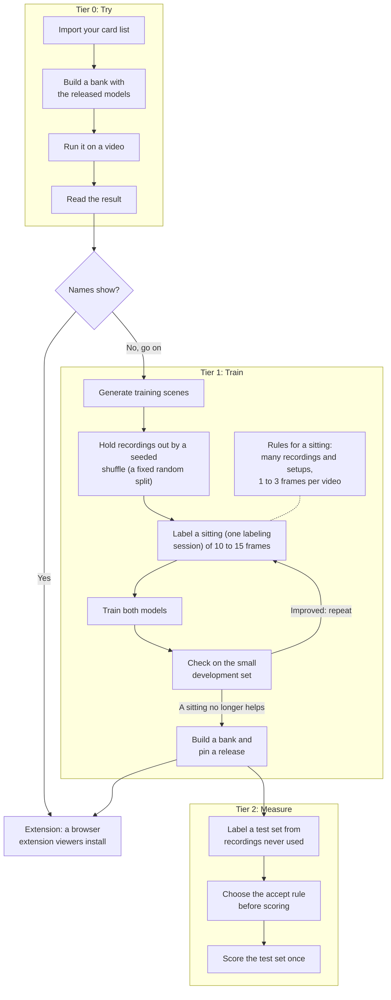

<!-- SPDX-License-Identifier: Apache-2.0 -->

# Start here

This toolkit finds trading cards in a video frame and names them, so that a viewer can rest
the pointer on a card and read it. It was built for Riftbound and is laid out so that you can
point it at your own game. Pick the line that fits you.

## Where to go

1. **Just curious?** Open the [hosted demo](https://ryangswe.github.io/riftsight-vision/):
   nothing to install. Move the pointer over the toy game's example table, or drop a
   screenshot or a video of a One Piece Card Game match. The models run in your browser.
2. **You have a list of your game's cards, such as a spreadsheet, and their images?**
   [Your game](your-game.md) takes you from those and a video to card names on that video,
   with the released models, on a laptop, in an afternoon. The [quickstart](quickstart.md)
   shows the tools on a toy game.
3. **Names show on your video?** Make a browser extension that viewers install to hover cards
   on YouTube and Twitch: [Extension](extension.md).
4. **They don't, or too few?** Train both models for your game: [Train](train.md). Be ready for
   a GPU (a rented one will do), some labeling and about a weekend.
5. **You want numbers you can publish?** Calibrate, then score held-out recordings once:
   [Measure](measure.md).

A coding agent follows the same path in [AGENTS.md](../AGENTS.md).

## What you do

**How to read it.** Boxes are steps, the diamond a decision, a dashed line a note. One loop
repeats: label, train, check.

1. **Tier 0: Try.** Import your card list into a catalog: every card's id, name, kind and
   image file. Build a bank from your card images with the released recognizer, run the
   released models on a video, and read what they named. It needs a laptop and no GPU.
2. **Names show?** If the cards you care about are named, go on to an extension. If not,
   tier 1 is the way forward.
3. **Tier 1: Train.** Generate training scenes from your card images. Before you train, split
   the recordings by a seeded shuffle (a fixed random split, so that no one picks the test
   videos): one you train on can never measure anything again. Label a sitting (one labeling
   session) of 10 to 15 frames, train both models, check them on frames you do not train on,
   and repeat while it helps. Then pin a release: one document that fixes the models, bank,
   catalog and accept rule together.
4. **Extension.** The example extension, Kenbunshoku, is copied, given your release and
   built.
5. **Tier 2: Measure** (once per decision). Label a separate test set from recordings never
   used for training or development. Settle the accept rule (`tau`, `delta`) on other
   recordings before you score. Then score the test set once, and report those figures.

## What you need

| What | For |
| --- | --- |
| macOS, Linux, or Ubuntu under WSL 2 on Windows | Everything. A native Windows shell is not supported ([quickstart](quickstart.md), "Which computer?") |
| Python 3.10 or later | Everything |
| Node 22 or later. On macOS: the installer from <https://nodejs.org>, or `brew install node` | The demo page, and an extension |
| A GPU | Train only. Nothing before it needs one |

## Your work folders

Everything you make stays outside the repository: images, videos and model files never go
into it. The pages use three folders in your Downloads folder, where you can find them:

| Folder | Holds | Set by |
| --- | --- | --- |
| `$WORK`, `cardvision-toy` | The toy game and what the toy steps write | The [quickstart](quickstart.md), [Train](train.md) and [Measure](measure.md) |
| `$GAME`, `my-game` | Your card list, images and video, and what the steps write for your game | [Your game](your-game.md) |
| `$WEIGHTS`, `cardvision-weights` | The released models | [Your game](your-game.md), step 0 ([Getting the released weights](release-files.md)) |

A new terminal forgets these variables: paste the page's `export` lines again.

## Prefer to watch?

Six walkthrough videos follow the same steps on the toy game, in
[one playlist](https://www.youtube.com/playlist?list=PLMxsDo8Cxri0):

- [The big picture](https://www.youtube.com/watch?v=4iPA6dzdODM)
- [Try the toy game: quickstart and demo page](https://www.youtube.com/watch?v=Xq8Dwal1f6E)
- [Label frames with the labeling tool](https://www.youtube.com/watch?v=eL0gChfpS_w)
- [Train for your game](https://www.youtube.com/watch?v=pu6TV2CmvwM)
- [Measure it](https://www.youtube.com/watch?v=sznZuj5Z6Uw)
- [Make it yours: your own browser extension](https://www.youtube.com/watch?v=tRTTq4P3sRU)

How the pipeline works, frame by frame, is in [how it works](how-it-works.md). Every other
page is listed in the [reference](reference.md).
